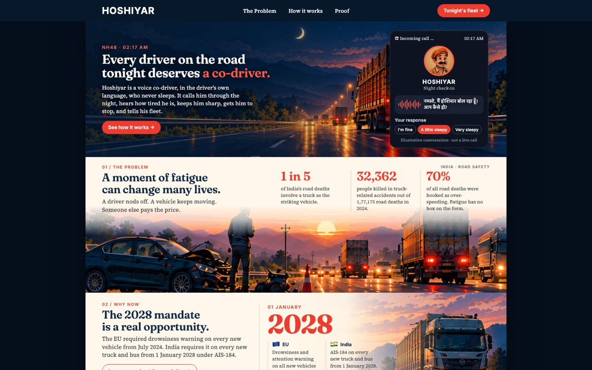
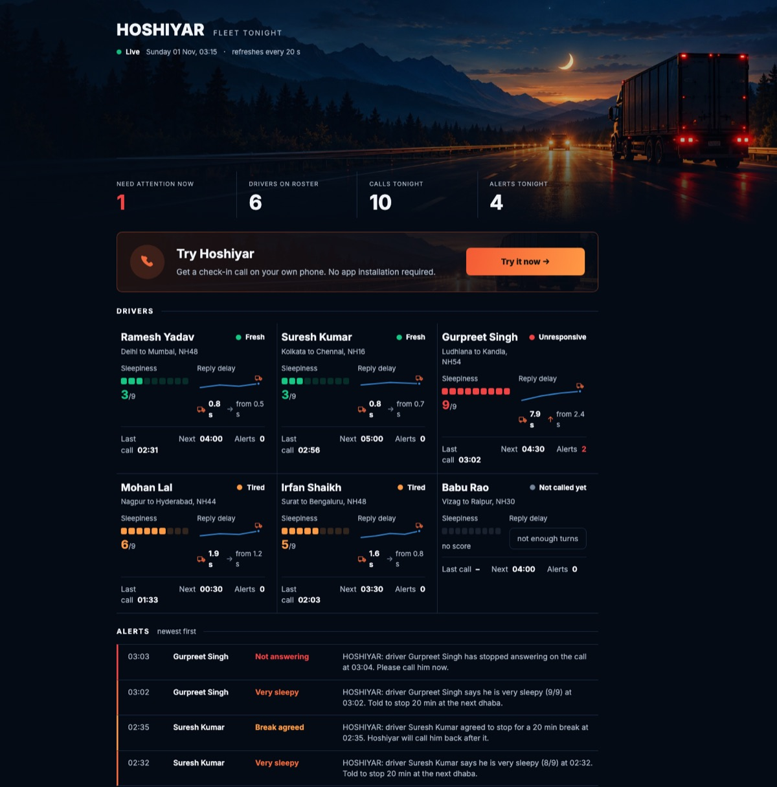

# Hoshiyar

**A voice co-driver for long-haul truck drivers.** It phones the driver through the night in his own language,
hears how tired he is, keeps him talking, gets him to stop when it is not safe, and tells his fleet.
Nothing goes into the cab: it works on the phone the driver already has.

**Live:** [ow2xj.aiccloud.online](https://ow2xj.aiccloud.online) · **Fleet screen:** [/fleet](https://ow2xj.aiccloud.online/fleet)
(press *Try it now* to get a real check-in call on your own phone)



---

## 01 · The problem: one road death in five involves a truck

| | |
|---|---|
| **32,362** | People killed in 2024 where a truck was the striking vehicle, out of India's 1,77,175 road deaths. |
| **49%** | Truck drivers who say they drive even when sleepy, after 11.9 hours at the wheel a day. |
| **0** | Boxes for fatigue on an Indian accident form. Most of these deaths are booked as over-speeding. |

## 02 · Why now: the mandate leaves today's trucks out

India makes driver drowsiness warning (AIS-184) mandatory on every new truck and bus from **1 January 2028**,
after the EU did the same in July 2024. The mandate covers trucks built after 2028, and the mandated device
only beeps. The trucks on the road tonight get nothing. Meanwhile, voice AI in Indian languages has become fast
and cheap enough to hold a real conversation over an ordinary phone line.

## 03 · The solution: a co-driver on a phone call

Hoshiyar does what a human co-driver does: it talks to the driver, notices when he is fading, and makes him stop.

```
Hoshiyar  नमस्ते, मैं होशियार बोल रहा हूँ। आप कैसे हो?          Hello, Hoshiyar here. How are you?
Driver    भाई, बहुत नींद आ रही है।                               Brother, I am very sleepy.
Hoshiyar  अगले ढाबे पर बीस मिनट रुक जाओ। तब तक बताओ,         Stop for twenty minutes at the next dhaba.
          राजस्थान की राजधानी क्या है?                           Till then: what is the capital of Rajasthan?
Driver    जयपुर।                                                  Jaipur.
```

*Illustrative. The bot's lines and the question come from the real persona and question bank.*

Behind the scenes, that call recorded a HEAVY sleepiness score and rang the fleet manager with a spoken alert.
Once the driver agrees to stop, a wake-up call is booked for twenty minutes later.

## 04 · The fleet manager sees the whole night on one screen



Each driver's state, sleepiness score, reply-delay trend, next check-in and alerts, refreshed every 20 seconds.
[Open it live.](https://ow2xj.aiccloud.online/fleet)

## 05 · How it works

```
Vobiz phone call ──wss──▶ FastAPI /ws ──▶ Pipecat pipeline
   Sarvam STT (saaras:v3) ▶ turn-taking ▶ Gemma 4 on Sarvam, with tools ▶ Sarvam TTS (bulbul:v3)
```

1. **Rota.** The scheduler rings each driver at his check-in times, redials on busy or no answer, and survives restarts.
2. **Score.** From the driver's own words the model records sleepiness from 1 to 9 and picks a mode:
   QUIET (one line, then silence), MILD (light talk), HEAVY (a break order, then a rapid quiz).
3. **Listen.** Reply delay is measured on every turn. If it climbs over the call, the bot asks again, whatever he says.
4. **Escalate.** A sleepy driver who ignores two nudges is marked unresponsive. HEAVY, unresponsive and break
   events each phone the fleet manager.
5. **Wake up.** After a break the driver gets a call back to check he is fit to drive on.

## 06 · Why it is different

| A drowsiness device | Hoshiyar |
|---|---|
| Fitted to new trucks from 2028 | Works on every truck tonight, on the driver's own phone |
| Beeps | Talks, asks, quizzes and orders a break |
| Tells the driver only | Phones the fleet manager when it matters |
| One language: a beep | Hindi, Telugu, Kannada, Marathi and English, switched mid-call |

## 07 · Proof: it is live and measured

- **Live** at [ow2xj.aiccloud.online](https://ow2xj.aiccloud.online), ringing real Indian phone numbers.
- **First word 0.35 s** after pickup; **0.6 s** from the driver finishing to the reply starting.
- **Under ₹1,000** per driver per month at list prices, for three calls a night.
- **Grounded in research:** a trivia task kept truck drivers alert in a simulator (Oron-Gilad et al. 2008),
  and fatigued drivers want stimulating talk while alert ones want silence. Hence the default is quiet.

## 08 · Next

- A night-shift pilot with a real fleet, to tune the score and the alert thresholds against what drivers report.
- More languages: Tamil, Bengali and Punjabi cover most of the remaining long-haul drivers.
- Feed the fleet's own trip data (hours driven, stops) into when and how often Hoshiyar calls.

---

## Engineering notes

- **Language switch mid-call.** Calls open in Hindi. If the driver answers in Telugu, Kannada, Marathi or English,
  the model offers those, and one tool call switches speech-to-text, text-to-speech and the persona together
  without hanging up. The Hindi path is pinned by a baseline test.
- **Barge-in that ignores "haan".** The driver interrupts only after three words, so a background "hmm" or
  "ji" does not cut the bot off mid-sentence.
- **Reply-delay drift.** It needs both an absolute and a relative rise against the driver's own baseline, so a
  naturally slow talker is not flagged ([`signals.py`](src/hoshiyar/signals.py)).
- **No invented facts.** HEAVY quizzes come from a fixed bank per language (capitals, old films, roads), with
  no arithmetic, because working-memory puzzles hurt driving.
- **Voice OTP.** The *Try* button reads a four-digit code to your phone before it books a call, with limits on
  attempts, bookings and calls per night.

## Run it yourself

You need Python 3.12, [uv](https://docs.astral.sh/uv/), and Sarvam and Vobiz accounts.

```sh
cp .env.example .env                  # fill in the keys
uv sync
ngrok http 7860                       # put the https URL in LOCAL_SERVER_URL
uv run python -m hoshiyar.server      # http://localhost:7860 and /fleet
```

The roster is `data/drivers.json` (copy `drivers.example.json`); add `"lang": "te"` to a driver to fix his language.
For a small VPS deployment, see [`deploy.md`](deploy.md).

**Tests.** These check the Try flow, the scheduler and the language switch, and place no calls:

```sh
uv run python tests/test_trials.py
uv run python tests/test_langs.py
```

## Sources

MoRTH, *Road Accidents in India 2024* · PIB release 2227148 (12 Feb 2026), safety devices for heavy vehicles ·
SaveLIFE Foundation, *Status of Truck Drivers in India* (2020) · AAA Foundation for Traffic Safety, *Prevalence
of Drowsy Driving Crashes* · Oron-Gilad, Ronen & Shinar (2008) · Atchley, Chan & Gregersen (2014).
